<div align="center">

  <!-- 01. Animated Hero Banner -->
  

  <br />

  <!-- Smooth Typing Tagline -->
  <a href="https://github.com/ghalibhussainnoohani">
    
  </a>

  <br />

  <!-- Curated Burgundy Identity Badges -->
  <p align="center">
    
    
    <a href="https://github.com/ghalibhussainnoohani?tab=followers"></a>
    <a href="mailto:noohanighalib@gmail.com"></a>
  </p>

</div>

---

### 💻 `ghalib@workspace:~$ cat about.json`

```json
{
  "engineer": "Ghalib Hussain",
  "role": "AI/ML Engineer & Creative Technologist",
  "specialization": "Real-Time Computer Vision • High-Throughput Systems • 3D WebGL",
  "focus": "Low-latency streaming architectures & autonomous vision pipelines",
  "philosophy": "Developing scalable software at the intersection of mathematical rigor and cinematic experience."
}
```

I am a Software Engineer and Creative Technologist focused on building resilient systems that solve complex computational problems. My work spans deep learning inference pipelines (YOLOv8, PyTorch), reactive full-stack web platforms (FastAPI, React), and interactive 3D simulations (WebGL, Three.js).

---

### 🏆 Key Engineering Achievements

- **Sub-50ms Vision Streaming:** Engineered an end-to-end multi-threaded frame acquisition and inference pipeline streaming annotated YOLOv8 object detections over MJPEG and WebSockets.
- **Procedural 3D WebGL Architecture:** Built an in-browser physics and rendering engine with custom Web Audio synthesis, curved track math, and zero external framework dependencies.
- **Enterprise-Grade System Design:** Architected asynchronous FastAPI microservices with normalized relational schemas, resilient SQLite/PostgreSQL failovers, and unified RESTful contracts.

---

### 🚀 Selected Project Showcase

<table>
  <tr>
    <td width="50%" valign="top">
      <h3 align="center">🏎️ 3D Anti-Gravity Racing</h3>
      <p align="center">
        <a href="https://ghalibhussainnoohani.github.io/3d-racing-game/">
          
        </a>
        <a href="https://github.com/ghalibhussainnoohani/3d-racing-game">
          
        </a>
      </p>
      <ul>
        <li>Real-time <b>Three.js / WebGL</b> racing simulation featuring anti-gravity vehicle physics.</li>
        <li>Custom audio synthesizer generating procedural techno soundscapes via <b>Web Audio API</b>.</li>
        <li>Adaptive telemetry dashboard, dynamic obstacle collision, and autonomous rival AI logic.</li>
      </ul>
      <p align="center"><code>Three.js</code> • <code>WebGL</code> • <code>JavaScript ES6+</code> • <code>Web Audio</code></p>
    </td>
    <td width="50%" valign="top">
      <h3 align="center">👁️ Technify VisionAI</h3>
      <p align="center">
        <a href="https://github.com/Sabakhoso/technify-visionai">
          
        </a>
        <a href="https://github.com/Sabakhoso/technify-visionai">
          
        </a>
      </p>
      <ul>
        <li>Real-time <b>YOLOv8 object detection</b> pipeline streaming annotated live feeds with sub-50ms latency.</li>
        <li>Multi-camera RTSP/Webcam orchestration with automatic zone monitoring and event triggers.</li>
        <li>Reactive <b>FastAPI</b> backend paired with a modern <b>Vite + React</b> control dashboard.</li>
      </ul>
      <p align="center"><code>FastAPI</code> • <code>YOLOv8</code> • <code>PyTorch</code> • <code>React</code> • <code>OpenCV</code></p>
    </td>
  </tr>
</table>

---

### 🧰 Technical Arsenal

<div align="center">
  <p><strong>AI, Vision & Core Engineering</strong></p>
  <a href="https://skillicons.dev">
    
  </a>
  <br /><br />
  <p><strong>Interactive 3D, Frontend & Mobile Systems</strong></p>
  <a href="https://skillicons.dev">
    
  </a>
</div>

<br />

<table>
  <thead>
    <tr>
      <th align="left">Domain</th>
      <th align="left">Verified Stack &amp; Libraries</th>
    </tr>
  </thead>
  <tbody>
    <tr>
      <td><b>Artificial Intelligence &amp; Vision</b></td>
      <td><code>Python</code> <code>PyTorch</code> <code>YOLOv8</code> <code>OpenCV</code> <code>NumPy</code> <code>Edge AI Inference</code></td>
    </tr>
    <tr>
      <td><b>Graphics &amp; Frontend</b></td>
      <td><code>JavaScript (ES6+)</code> <code>TypeScript</code> <code>React</code> <code>Three.js</code> <code>WebGL</code> <code>TailwindCSS</code> <code>HTML5/CSS3</code></td>
    </tr>
    <tr>
      <td><b>Backend &amp; Distributed Systems</b></td>
      <td><code>FastAPI</code> <code>Node.js</code> <code>WebSockets</code> <code>MJPEG Streaming</code> <code>RESTful APIs</code> <code>Uvicorn</code></td>
    </tr>
    <tr>
      <td><b>Databases, DevOps &amp; Tooling</b></td>
      <td><code>PostgreSQL</code> <code>SQLite</code> <code>Docker</code> <code>Git</code> <code>GitHub Actions</code> <code>Linux</code> <code>VS Code</code></td>
    </tr>
  </tbody>
</table>

---

### 🐍 Contribution Activity

<div align="center">
  
</div>

---

### 📊 Real-Time GitHub Analytics

<div align="center">
  <table border="0">
    <tr>
      <td align="center">
        
      </td>
      <td align="center">
        
      </td>
    </tr>
  </table>

  <br />

  <p align="center">
    
  </p>
</div>

---

### 🌐 Connect & Collaborate

<div align="center">
  <p>Open to discussions regarding AI architecture, high-performance web systems, and 3D graphics engineering.</p>
  
  <p align="center">
    <a href="https://github.com/ghalibhussainnoohani">
      
    </a>
    &nbsp;
    <a href="mailto:noohanighalib@gmail.com">
      
    </a>
  </p>

  <br />

  <!-- 09. Minimal Animated SVG Footer -->
  

</div>
